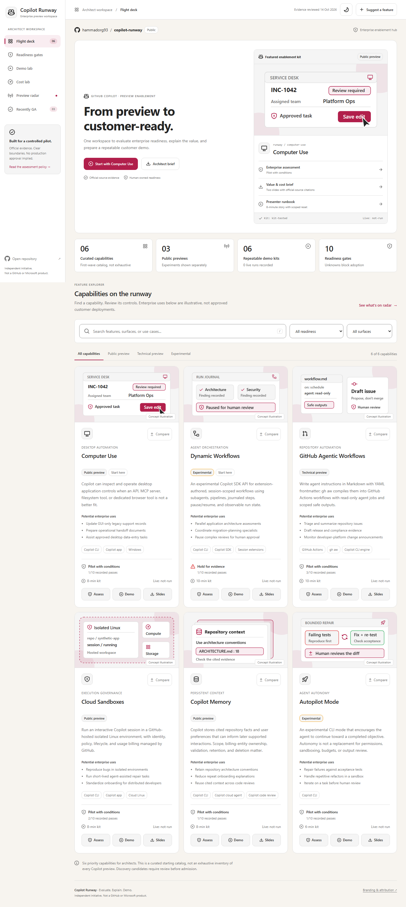
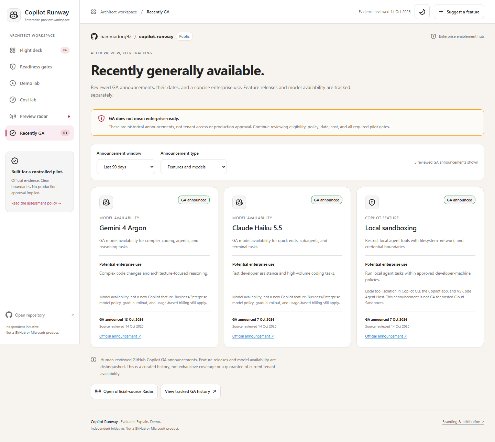

# Copilot Runway

**Evaluate. Explain. Demo.**

[](https://github.com/hammadorg93/copilot-runway/actions/workflows/pages.yml)
[](https://github.com/hammadorg93/copilot-runway/actions/workflows/ci.yml)

**[Open the public app](https://hammadorg93.github.io/copilot-runway/)** | **[Browse Recently GA](https://hammadorg93.github.io/copilot-runway/#view=ga)** | **[Presenter runbooks](demos/README.md)** | **[Enterprise policy](readiness/README.md)**

Copilot Runway is an independent workspace for Cloud Solution Architects preparing customer conversations about **GitHub Copilot preview features**. It connects the potential enterprise use, required controls, official-source evidence, value/cost story, and a repeatable demo in one place.

**Current kit:** 6 assessed capabilities | 10 required readiness gates | 6 demo kits | 12 sourced slides | a separate reviewed GA history.



*Flight deck snapshot, 14 October 2026. The counts and findings are curated evidence, not exhaustive product coverage or production certification.*

## What you can do in the app

| Workspace | What it helps you do | What you leave with |
| --- | --- | --- |
| **Flight deck** | Search features and enterprise use cases; filter by lifecycle, surface, and readiness; compare up to three capabilities | A scoped feature shortlist with visible caveats |
| **Readiness gates** | Inspect every non-negotiable and its owner, evidence, and test; propose local workshop requirements | A source-backed assessment and exportable proposed policy |
| **Demo lab** | Rehearse a synthetic control story; open the real-feature presenter kit; copy setup, verify, and reset commands | A repeatable demo plan with expected evidence and cleanup boundaries |
| **Cost lab** | Change AI-credit and cloud-sandbox assumptions and inspect the published meter arithmetic | An exportable illustrative estimate, not a tenant quote |
| **Preview radar** | Review daily official-source preview, release, policy, billing, and lifecycle signals | Candidates to investigate, not automatically admitted features |
| **Recently GA** | Filter reviewed announcements by date and feature/model type, and inspect primary sources | Durable GA history plus a separate queue of unverified new GA signals |

The site, slides, assessments, and runbooks are **public** and need no GitHub sign-in to view. Opening issues or proposing repository changes requires the appropriate GitHub account and permissions.

The portal uses a responsive Microsoft Fluent-inspired shell and GitHub Primer-style feature explorer, Segoe typography, official Octicons, and light/dark themes. It is a self-contained static app: **no runtime API or model calls, analytics, remote fonts, customer data, or live automation**. Runbooks explain how to exercise the real products separately.

Each feature now has an original, theme-aware **concept illustration**: a GUI service-desk edit, specialist journal, governed workflow draft, isolated cloud session, cited repository context, or bounded test-repair cycle. Click the illustrated cover for its control story and download a self-contained SVG for customer conversations. These are clearly labeled illustrations, not official product screenshots or evidence of a live run. Maintain them in `site/feature-visuals.mjs`; the build embeds them offline and exports `dist\artifacts\visuals\<feature-id>.svg` without changing assessed feature evidence or slide fingerprints.

Press `/` to focus capability search. Release-stage filters and result counts remain visible on mobile; the navigation scrolls to the selected view. The comparison tray stays available while scrolling and leaves space at the end of the page so it does not cover the final controls.

## A customer-session journey

1. **Pick a business scenario.** Search for a use case such as `legacy support records` or choose a feature. The three short enterprise uses under each card are conversation starters, not customer references.
2. **Evaluate before enabling.** Open **Assess**, inspect all ten gates, and identify missing tenant evidence and named owners. Compare capabilities without averaging away a blocking unknown.
3. **Explain the value and cost.** Download the sourced feature slides, review the explicit assumptions, and use **Cost lab** to export a scenario.
4. **Rehearse, then demo deliberately.** Use the offline rehearsal first. For a real Copilot run, follow the full runbook, approved prerequisites, expected output, verification, and scoped local/remote cleanup.
5. **Keep the recommendation current.** Check **Preview radar** and **Recently GA**. A GA announcement does not grant tenant access or automatically satisfy enterprise controls.

## First-wave catalog

| Capability | Verified lifecycle | Pilot posture | Demo surface |
| --- | --- | --- | --- |
| [Computer Use](features/computer-use/assessment.md) | Public preview | Pilot with conditions | Native Windows/macOS app |
| [Dynamic Workflows](features/dynamic-workflows/assessment.md) | Experimental SDK API | Hold: admin-control and persisted-data evidence gaps | Session-scoped SDK extension |
| [GitHub Agentic Workflows](features/agentic-workflows/assessment.md) | Technical preview | Pilot with conditions | GitHub Actions / `gh aw` |
| [Cloud Sandboxes](features/cloud-sandboxes/assessment.md) | Public preview; experimental CLI flag | Pilot with conditions | Interactive cloud Linux |
| [Copilot Memory](features/copilot-memory/assessment.md) | Public preview | Pilot with conditions | Cited repository context |
| [Autopilot Mode](features/autopilot/assessment.md) | Experimental | Pilot with conditions | Bounded local repair/test task |

Official sources were reviewed on **2026-10-14**. This is a curated first wave, **not an exhaustive list of all Copilot previews**. Lifecycle, policy, pricing, and eligibility can change. The UI treats evidence older than 30 days as stale and blocks required gates pending re-review.

**Kit-tested is not live-feature-tested.** Fixtures, acceptance checks, offline orchestration, and repeatable reset are exercised by repository tests. Live account access, native app automation, paid SDK/Actions inference, cloud execution, server-side Memory, and tenant-specific policy enforcement are not claimed from those checks.

## Enterprise uses and GA history

Every feature card and Overview includes three short **potential enterprise uses**, searchable alongside the feature's name and surfaces. These are illustrative recommendations, not verified customer deployments or policy approval.

| Capability | Example enterprise conversation starter |
| --- | --- |
| Computer Use | Update GUI-only legacy support records |
| Dynamic Workflows | Parallel application architecture assessments |
| GitHub Agentic Workflows | Draft release and compliance evidence |
| Cloud Sandboxes | Reproduce bugs in isolated environments |
| Copilot Memory | Retain repository architecture conventions |
| Autopilot Mode | Repair failures against acceptance tests |

**[Recently GA](https://hammadorg93.github.io/copilot-runway/#view=ga)** defaults to announcements from the last 90 days, with 30-day/all-history and feature/model filters. The initial reviewed history includes local sandboxing (2026-10-07), Claude Haiku 5.5 model availability (2026-10-07), and Gemini 4 Argon model availability (2026-10-13). Local sandboxing's GA announcement does **not** graduate hosted Cloud Sandboxes.



*GA tracker snapshot, 14 October 2026. Model availability is labeled separately from feature GA; neither implies customer-specific approval.*

The human-reviewed archive in `catalog/ga.json` survives feed rollover. To add an entry, verify the primary announcement, register its source/review date in `catalog/sources.json`, and record its GA date, type, concise potential enterprise use, and scope caveat. Daily scans surface new GA-looking announcements as **review-pending signals**, excluding already tracked announcement URLs. Retirement, stable CLI releases, and historical GA mentions are not proof of a feature graduation. Coverage is curated and bounded, not exhaustive; **GA never automatically changes enterprise readiness or tenant eligibility**.

## Enterprise non-negotiables

Use [the readiness policy](readiness/README.md), [versioned gate definitions](readiness/gates.json), and [customer assessment template](readiness/assessment-template.md). Every feature is assessed against availability, admin control, least privilege, data boundaries, human approval, audit, cost, network, operations, and rollback.

Required unknown, failed, missing, or stale evidence blocks readiness. Conditions require a named owner and actual tenant evidence. No weighted score or marketing badge can override a blocking gate. **Pilot gates satisfied never means production-certified.**

The Pages workshop can add local proposed requirements and export JSON. Repository policy changes require review, a rubric version change where appropriate, and an assessment for every feature.

## Value, cost, and official branding

[Download the combined 12-slide architect brief](artifacts/slides/copilot-runway.pptx), or open the two-slide deck linked from each feature. Briefs cover value, control story, readiness, cost assumptions, and how to start the demo; primary-source hyperlinks and detailed notes are embedded.

Enterprise Copilot usage is measured in **AI credits** under the reviewed current billing documentation. Do not reuse legacy premium-request assumptions as current enterprise pricing. Cloud sandbox compute, allocated memory, and snapshot storage are separate meters. The Cost lab is explicitly illustrative and excludes seats, Actions, taxes, and other services.

Official Copilot/GitHub icons come from pinned Primer Octicons. [Attribution and brand guidance](THIRD_PARTY_NOTICES.md) are included with the site and decks.

## Run and reset a demo

Use Node.js 22 or later:

```powershell
npm ci
npm run demo:setup -- computer-use
npm run demo:verify -- computer-use
npm run demo:reset -- computer-use
```

Follow the [presenter runbooks](demos/README.md) for real-feature prerequisites and steps. Setup prints an absolute path under `.demo-workspaces\<feature-id>`. Verification intentionally fails until the specified result exists. Autopilot's seeded acceptance tests fail again after reset.

Reset is marker-checked, rejects unknown files and symlinks/junctions, and touches only known synthetic files. **It does not revoke app permissions, delete memories/journals, stop cloud sessions, remove snapshots, close PRs, or reset account settings.** Those are separate, specifically authorized steps in the runbook.

The Dynamic Workflows extension registers `runway-architecture-review` on a compatible CLI without starting it, requesting secrets, or declaring guessed limits. Its real workflow includes runtime input validation, distinct agent labels, an explicitly selected **tool-free specialist profile**, null/failure handling, an input-versioned journal, and a human review checkpoint. `demo:rehearse` uses deterministic adapters and incurs no inference.

## Run the app locally

```powershell
npm ci
npm run dev
```

Use **Node.js 22 or later**. `npm run dev` builds the app and serves only generated `dist` content at **http://127.0.0.1:4173**. The committed assessment/slide artifacts are used as-is; regenerating them is unnecessary just to run the portal.

For offline viewing, run `npm run build` and open `dist\index.html` directly. Keep its sibling folders for slide, assessment, and runbook downloads. `?clawpilotTheme=light` or `?clawpilotTheme=dark` selects an explicit theme.

## Validate and maintain

```powershell
npm run validate
npm test
npm run artifacts:check
python scripts\verify_pptx.py
npx playwright install chromium
npm run build
npm run test:e2e
```

Unit tests cover blocking verdicts, stale/invalid evidence, enterprise-use coverage/search, GA history/filtering/deduplication, cost arithmetic, discovery boundaries, workflow failure/resume, the original seeded symptom, exact output contracts, and reset safety. Browser tests exercise all six workspace views and every feature's assessment/demo/slides actions, tabs, command-copy handlers, presenter downloads, offline rehearsal/stop/reset controls, plus filters, comparison limits, policy exports, cost exports, focus, mobile targets, contrast, themes, stale evidence, CSP, and offline operation. Clipboard success/denial paths are isolated in tests; they do not write the operator's desktop clipboard.

Maintain portal recommendations in the `enterpriseUseCases` map in `catalog/features.json`. Validation requires concise examples for every known feature. They do not change generated assessments, slide inputs, or readiness evidence.

After changing authoritative feature/rubric/referenced-source content, regenerate the decks and Markdown with `npm run artifacts`. Portal-only enterprise-use recommendations and GA archive entries do not require slide regeneration; the evidence fingerprints remain enforced. `artifacts:check` rejects stale fingerprints. On a Windows machine with PowerPoint, `scripts\render-slides.ps1` exports the actual combined deck to `qa-results\slides` for visual QA; it closes only the presentation it opened.

## Staying current

| Automation | Schedule | Actual behavior |
| --- | --- | --- |
| `preview-discovery.yml` | Daily 09:17 UTC + manual | Fetches official Copilot RSS and CLI/gh-aw releases, preserves a bounded snapshot, and updates one deduplicated bot-owned issue digest. No model required. |
| `pages.yml` | Main push, daily 09:47 UTC, manual | Validates reviewed content, refreshes candidate-only Radar, builds, browser-tests, and deploys Pages. Failed ingestion or browser checks stop publication and do not replace the last deployed site. |
| `preview-scout.md` + `.lock.yml` | Weekly Monday + manual, **opt-in** | Uses a read-only agent and restricted safe outputs to propose one draft candidate-review PR. It cannot admit a feature, promote readiness, merge, or deploy. |
| `ci.yml` | Main push + PR + manual | Checks data, tests, artifact evidence, browser behavior, and matching compiled workflow source. |
| Dependabot | Weekly | Proposes npm and Actions pin updates for review. Compiler upgrades need explicit source/lock review. |

The official watchlist is in `catalog/watch.json`; `npm run sources:scan -- --update` refreshes only `catalog/monitor.json`. Responses and redirects are host-allowlisted, size/time bounded, parsed as inert data, and fail explicitly. RSS is a rolling window, not complete history. Signals include GA, retirement, policy, billing, and release changes as well as previews.

**Agentic authentication is not configured by this repository.** An administrator must approve the engine/budget, configure the documented `COPILOT_GITHUB_TOKEN` secret securely, and set `RUNWAY_AGENTIC_ENABLED=true`. Until then, the reasoning workflow is intentionally skipped; deterministic discovery and Pages still operate. Do not put tokens in source, screenshots, logs, or command history. See [automation setup](docs/automation.md).

## Repository map

| Path | Source of truth / purpose |
| --- | --- |
| `catalog/` | Structured feature evidence, portal use cases, reviewed GA history, verified sources, watchlist, discovery-only snapshot, candidate proposals |
| `readiness/` | Versioned required gates and assessment template |
| `features/` | Generated Markdown assessments |
| `artifacts/slides/` | Generated, cited PowerPoint briefs |
| `demos/` | Real-feature runbooks, synthetic fixtures, experimental orchestration logic |
| `site/` | Static portal source and shared pure assessment/calculation model |
| `docs/` | Automation trust boundaries and illustrative UI screenshots |
| `scripts/` | Validation, build, discovery, scoped demo setup/reset, and artifact generation |
| `.github/workflows/` | CI, Pages, discovery, and source/compiled agentic scout |
| `.github/agents/` | Explicit tool-free Dynamic Workflows specialist profile |

Keep credentials, customer data, personal information, and confidential material out of the repository and generated Pages assets. Both are deliberately public. Publish only non-confidential, synthetic enablement material.
