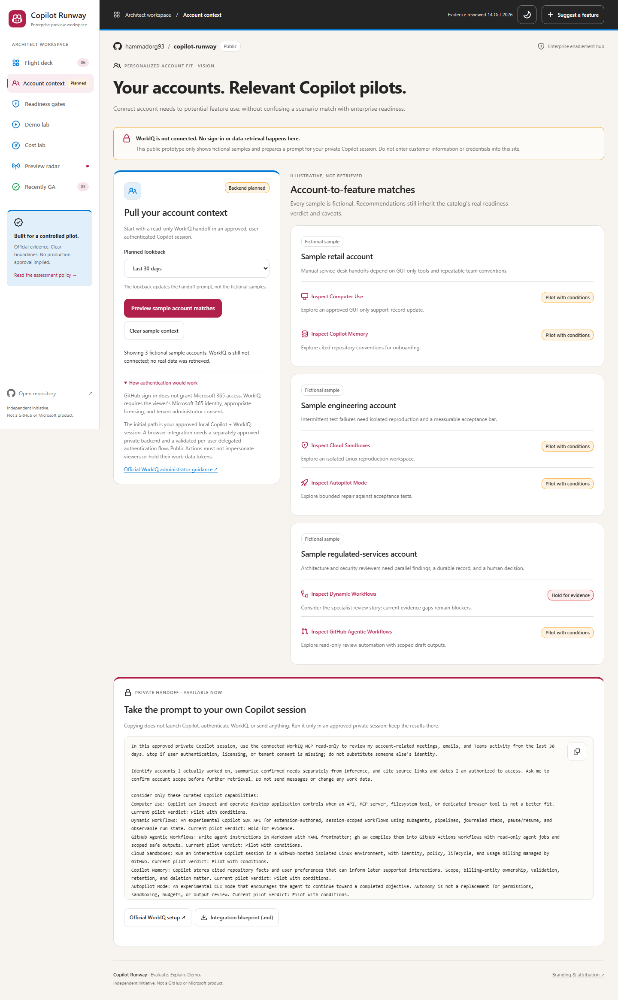
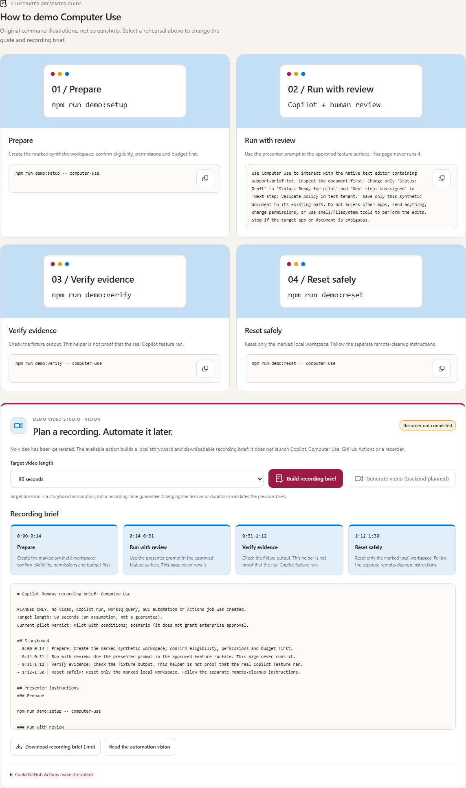

# Copilot Runway

**Evaluate. Explain. Demo.**

[](https://github.com/aj-enns/copilot-runway/actions/workflows/pages.yml)
[](https://github.com/aj-enns/copilot-runway/actions/workflows/ci.yml)

**[Open the public app](https://aj-enns.github.io/copilot-runway/)** | **[Browse Recently GA](https://aj-enns.github.io/copilot-runway/#view=ga)** | **[Presenter runbooks](demos/README.md)** | **[Enterprise policy](readiness/README.md)**

Copilot Runway helps Cloud Solution Architects prepare customer conversations about **GitHub Copilot preview features**. It brings enterprise use cases, controls, official evidence, value and cost, and demo guidance together.

**Curated baseline:** 6 assessed capabilities | 10 required readiness gates | 6 demo kits | 12 sourced slides | a separate reviewed GA history. Configured automation can add explicitly unverified kits; the app shows current totals.


*Snapshot: 14 October 2026. Counts and findings are curated, not exhaustive or a production certification.*

## What you can do in the app

| Workspace | What it helps you do | What you leave with |
| --- | --- | --- |
| **Flight deck** | Search and compare features; filter by lifecycle, surface, and readiness | A shortlist with visible caveats |
| **Account context** | Preview fictional matches and prepare a private WorkIQ handoff | A read-only prompt and integration blueprint—not account data |
| **Readiness gates** | Review required gates or propose workshop requirements | A sourced assessment and exportable proposal |
| **Demo lab** | Rehearse controls, follow runbooks, and plan a recording | A demo plan and recording brief—not a video |
| **Cost lab** | Adjust AI-credit and cloud-sandbox assumptions | An illustrative estimate—not a tenant quote |
| **Preview radar** | Review daily official-source signals | Candidates to investigate—not admitted features |
| **Recently GA** | Filter reviewed announcements and inspect sources | A reviewed history and separate queue of unverified signals |

The site, slides, assessments, and runbooks are **public** and need no GitHub sign-in to view. Opening issues or proposing repository changes requires the appropriate GitHub account and permissions.

The portal is a self-contained static app with a responsive Fluent-inspired shell, Primer-style feature explorer, Segoe typography, official Octicons, and light/dark themes. Shared color tokens improve scanning but never affect readiness. The app makes **no runtime API or model calls**, and uses no analytics, remote fonts, customer data, or live automation. Runbooks cover real product use separately.

Each feature has an original, theme-aware **concept illustration**. Open one to read its control story or download its self-contained SVG. Illustrations are not product screenshots or live-run evidence. Maintain them in `site/feature-visuals.mjs`; the offline build exports `dist\artifacts\visuals\<feature-id>.svg` without changing assessments or slide fingerprints.

Press `/` to focus search. On mobile, release filters and result counts remain visible, navigation scrolls to the selected view, and the comparison tray leaves room for the final controls.

## New front-end concepts: account context and demo video studio

**[Pull your account context](https://aj-enns.github.io/copilot-runway/#view=context)** is an unconnected WorkIQ concept. Preview three fictional accounts, review readiness-aware matches, choose a 7/30/90-day handoff window, and copy a read-only prompt for your **approved private Copilot + WorkIQ session**. The page does not sign in, launch Copilot, access Microsoft 365, or store results. GitHub sign-in is not Microsoft 365 authentication; WorkIQ requires appropriate licensing and tenant admin consent.



**[Demo lab](https://aj-enns.github.io/copilot-runway/#view=demos)** provides a feature illustration and **prepare / run with review / verify / reset** instructions. The video studio builds a 90-second or 3-minute storyboard and downloadable recording brief. **Generate video** is disabled; no recorder, model, Computer Use session, or Actions job runs.



The [integration blueprint](docs/integration-vision.md) separates the current front end from future private authentication and recording services. Computer Use is documented for **local macOS/Windows**; unattended desktop recording in Actions is unvalidated. Never put real work context in Pages, commits, Actions logs/artifacts, or public demos. Pages deployment is unchanged.

## A customer-session journey

1. **Choose a scenario.** Search a use case such as `legacy support records` or select a feature. Card examples are conversation starters, not customer references.
2. **Check readiness.** Review all ten **Assess** gates, missing tenant evidence, and owners. A blocking unknown cannot be averaged away.
3. **Explain value and cost.** Review sourced slides and assumptions; export a scenario from **Cost lab**.
4. **Rehearse, then demo.** Start offline. For a live run, follow the runbook's prerequisites, verification, and scoped cleanup.
5. **Refresh the recommendation.** Check **Preview radar** and **Recently GA**. A GA announcement does not grant access or satisfy enterprise controls.

## First-wave catalog

| Capability | Verified lifecycle | Pilot posture | Demo surface |
| --- | --- | --- | --- |
| [Computer Use](features/computer-use/assessment.md) | Public preview | Pilot with conditions | Native Windows/macOS app |
| [Dynamic Workflows](features/dynamic-workflows/assessment.md) | Experimental SDK API | Hold: admin-control and persisted-data evidence gaps | Session-scoped SDK extension |
| [GitHub Agentic Workflows](features/agentic-workflows/assessment.md) | Technical preview | Pilot with conditions | GitHub Actions / `gh aw` |
| [Cloud Sandboxes](features/cloud-sandboxes/assessment.md) | Public preview; experimental CLI flag | Pilot with conditions | Interactive cloud Linux |
| [Copilot Memory](features/copilot-memory/assessment.md) | Public preview | Pilot with conditions | Cited repository context |
| [Autopilot Mode](features/autopilot/assessment.md) | Experimental | Pilot with conditions | Bounded local repair/test task |

Sources were reviewed **2026-10-14**. This curated first wave is not exhaustive. Lifecycle, policy, pricing, and eligibility can change; evidence older than 30 days is stale and blocks required gates pending review.

**Kit-tested does not mean live-feature-tested.** Repository tests cover fixtures, acceptance checks, offline orchestration, and reset—not live account access, native app automation, paid inference, cloud execution, server-side Memory, or tenant policy.

## Enterprise uses and GA history

Feature cards and Overview list three searchable **potential enterprise uses**. These are illustrative—not verified deployments or policy approvals.

| Capability | Example enterprise conversation starter |
| --- | --- |
| Computer Use | Update GUI-only legacy support records |
| Dynamic Workflows | Parallel application architecture assessments |
| GitHub Agentic Workflows | Draft release and compliance evidence |
| Cloud Sandboxes | Reproduce bugs in isolated environments |
| Copilot Memory | Retain repository architecture conventions |
| Autopilot Mode | Repair failures against acceptance tests |

**[Recently GA](https://aj-enns.github.io/copilot-runway/#view=ga)** defaults to the last 90 days and supports 30-day/all-history and feature/model filters. The reviewed history includes local sandboxing (2026-10-07), Claude Haiku 5.5 availability (2026-10-07), and Gemini 4 Argon availability (2026-10-13). Local sandboxing's GA announcement does **not** graduate hosted Cloud Sandboxes.


*GA tracker snapshot, 14 October 2026. Model availability is labeled separately from feature GA; neither implies customer-specific approval.*

The reviewed `catalog/ga.json` archive survives feed rollover. Before adding an entry, verify its primary announcement and register the source/review date in `catalog/sources.json`; record the GA date, type, potential use, and scope caveat. Daily scans flag new GA-looking announcements for review and exclude archived URLs. Retirement, stable CLI releases, and historical mentions do not prove a feature graduated. Coverage is bounded; **GA never changes readiness or tenant eligibility automatically**.

## Enterprise non-negotiables

See the [readiness policy](readiness/README.md), [gate definitions](readiness/gates.json), and [assessment template](readiness/assessment-template.md). Gates cover availability, admin control, least privilege, data, human approval, audit, cost, network, operations, and rollback.

Unknown, failed, missing, or stale required evidence blocks readiness. Conditions need a named owner and tenant evidence; scores and badges cannot override a gate. **Passed pilot gates do not certify production readiness.**

The Pages workshop exports locally proposed requirements as JSON. Changing repository policy requires review, a rubric version update when needed, and reassessment of every feature.

## Value, cost, and official branding

[Download the combined architect brief](artifacts/slides/copilot-runway.pptx) or a feature's two-slide deck. Briefs cover value, controls, readiness, cost assumptions, and demo steps, with linked sources and notes.

Enterprise Copilot usage is measured in **AI credits**; do not use legacy premium-request assumptions as current pricing. Cloud sandbox compute, memory, and snapshot storage are separate meters. Cost lab estimates are illustrative and exclude seats, Actions, taxes, and other services.

Official Copilot/GitHub icons come from pinned Primer Octicons. [Attribution and brand guidance](THIRD_PARTY_NOTICES.md) are included with the site and decks.

## Run and reset a demo

Use Node.js 22 or later:

```powershell
npm ci
npm run demo:setup -- computer-use
npm run demo:verify -- computer-use
npm run demo:reset -- computer-use
```

Follow the [presenter runbooks](demos/README.md) for prerequisites and steps. Setup prints a workspace path under `.demo-workspaces\<feature-id>`. Verification fails until the expected result exists; Autopilot's seeded tests fail again after reset.

Reset is marker-checked and rejects unknown files and symlinks/junctions. It touches only synthetic files. **It does not revoke app permissions, delete memories/journals, stop cloud sessions, remove snapshots, close PRs, or reset account settings.** Authorize those separately as described in the runbook.

The Dynamic Workflows extension registers `runway-architecture-review` without starting it or requesting secrets. Its workflow validates inputs, uses a **tool-free specialist profile**, handles failures, journals versioned inputs, and pauses for human review. `demo:rehearse` uses deterministic adapters; it incurs no inference.

## Run the app locally

```powershell
npm ci
npm run dev
```

Use **Node.js 22 or later**. `npm run dev` builds and serves generated `dist` at **http://127.0.0.1:4173**. Committed assessments and slides are used as-is; no regeneration is needed to run the portal.

For offline viewing, run `npm run build` and open `dist\index.html`; keep sibling folders for downloads. Use `?clawpilotTheme=light` or `?clawpilotTheme=dark` to select a theme.

## Validate and maintain

```powershell
npm run validate
npm test
npm run artifacts:check
python scripts\verify_pptx.py
npx playwright install chromium
npm run build
npm run test:e2e
```

Unit tests cover verdicts, evidence freshness, use-case search, GA history, cost arithmetic, discovery boundaries, workflow failure/resume, output contracts, and reset safety. Browser tests cover all six workspaces, feature actions, downloads, rehearsal controls, filters, exports, accessibility, themes, CSP, and offline use. Clipboard tests never change the operator's clipboard.

Maintain recommendations in `catalog/features.json`'s `enterpriseUseCases` map. Every feature needs concise examples; they do not change assessments, slides, or readiness evidence.

After changing feature, rubric, or referenced-source content, run `npm run artifacts` to regenerate decks and Markdown. Enterprise-use recommendations and GA archive entries do not require slide regeneration; `artifacts:check` enforces evidence fingerprints. On Windows with PowerPoint, `scripts\render-slides.ps1` exports the combined deck to `qa-results\slides` and closes only the presentation it opened.

### Code boundaries

| Layer | Responsibility |
| --- | --- |
| `shared/evidence.mjs` | Pure source-reference, lifecycle, freshness, filtering, and readiness rules |
| `shared/recipes.mjs` | Pure synthetic recipe validation and execution |
| `shared/text.mjs`, `shared/validation.mjs` | Escaping, display dates, and structural validation primitives |
| `site/` | DOM rendering and UI state; workshop and demo studio own their controllers |
| `scripts/github.mjs` | GitHub HTTP transport with an injected fetcher; no authorization or publication policy |
| `scripts/release.mjs` | Release safeguards and operations with explicit repository, credentials, clock, Git, and output dependencies |

Shared modules must not import Node APIs or access the DOM. The existing `site/model.mjs` exports remain compatible; new cross-runtime logic belongs in `shared/`. Keep stricter automated-publication and recipe controls at their boundaries rather than weakening them into one permissive validator.

The build uses pinned esbuild to bundle browser modules into the self-contained HTML. CSP hashes are computed from the final inline bundle; the deployed portal still makes no runtime network calls. GitHub API requests happen only in Node tooling. Official-source fetching retains its separate allowlist, redirect, and size controls. Mutating GitHub calls are not automatically retried.

Slide generation normalizes ZIP and core-property timestamps to a fixed packaging date. Repeated generation with unchanged content produces identical bytes; content and template changes still regenerate every deck. Package timestamps are not human verification dates or evidence dates.

## Staying current

| Automation | Schedule | Actual behavior |
| --- | --- | --- |
| `preview-discovery.yml` | Daily 09:17 UTC + manual | Fetches official Copilot RSS and CLI/gh-aw releases, preserves a bounded snapshot, and updates one deduplicated bot-owned issue digest. No model required. |
| `pages.yml` | Main push, daily 09:47 UTC, manual | Validates reviewed content, refreshes candidate-only Radar, builds, browser-tests, and deploys Pages. Failed ingestion or browser checks stop publication and do not replace the last deployed site. |
| `preview-scout.md` + `.lock.yml` | Daily + manual, **opt-in** | Researches major official signals and weekly evidence reviews; proposes data only. |
| `feature-producer.yml` | After successful scout, **opt-in** | Validates grounded research and generates/tests complete data-only feature kits. |
| `feature-release.yml` | After successful release-PR CI, **opt-in** | Uses a restricted App to merge only exact validated content; main-push Pages publishes it. |
| `ci.yml` | Main push + PR + manual | Checks data, tests, artifact evidence, browser behavior, and matching compiled workflow source. |
| Dependabot | Weekly | Proposes npm and Actions pin updates for review. Compiler upgrades need explicit source/lock review. |

`catalog/watch.json` is the official watchlist. `npm run sources:scan -- --update` refreshes only `catalog/monitor.json`. Fetches and redirects are host-allowlisted and size/time bounded; content is inert data and failures are explicit. RSS is not complete history. Signals cover GA, retirement, policy, billing, releases, and previews.

**This repository does not configure Agentic authentication.** An administrator must approve the engine and budget, securely configure `COPILOT_GITHUB_TOKEN`, and set `RUNWAY_AGENTIC_ENABLED=true`. Until then, only deterministic discovery and Pages run. Never put tokens in source, screenshots, logs, or command history. See [automation setup](docs/automation.md).

For continuous Flight deck updates, follow [feature automation](docs/feature-automation.md). Research, generation, and publication have separate opt-ins. Complete machine-assessed kits can publish with **Hold for evidence**, but never claim human verification or live validation. Unsupported demos and incomplete evidence output stay pending; no agent can change executable infrastructure or readiness policy.

## Repository map

| Path | Source of truth / purpose |
| --- | --- |
| `catalog/` | Structured feature evidence, portal use cases, reviewed GA history, verified sources, watchlist, discovery-only snapshot, candidate proposals |
| `readiness/` | Versioned required gates and assessment template |
| `features/` | Generated Markdown assessments |
| `artifacts/slides/` | Generated, cited PowerPoint briefs |
| `demos/` | Real-feature runbooks, synthetic fixtures, experimental orchestration logic |
| `site/` | Static portal source, UI controllers, and portal-specific calculation/workshop model |
| `shared/` | Runtime-independent evidence, recipes, text, and validation helpers |
| `docs/` | Automation trust boundaries, context/video integration blueprint, and illustrative UI screenshots |
| `scripts/` | Validation, build, discovery, scoped demo setup/reset, and artifact generation |
| `.github/workflows/` | CI, Pages, discovery, and source/compiled agentic scout |
| `.github/agents/` | Explicit tool-free Dynamic Workflows specialist profile |

Keep credentials, customer data, personal information, and confidential material out of the repository and generated Pages assets. Both are deliberately public. Publish only non-confidential, synthetic enablement material.
